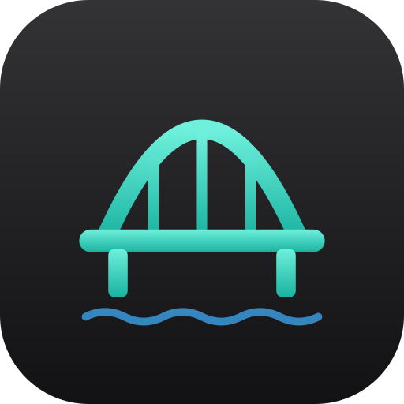
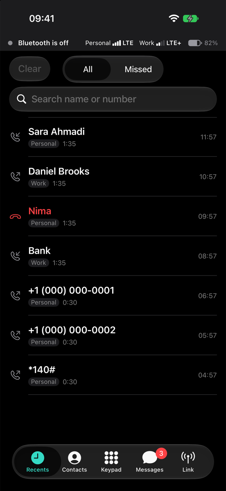
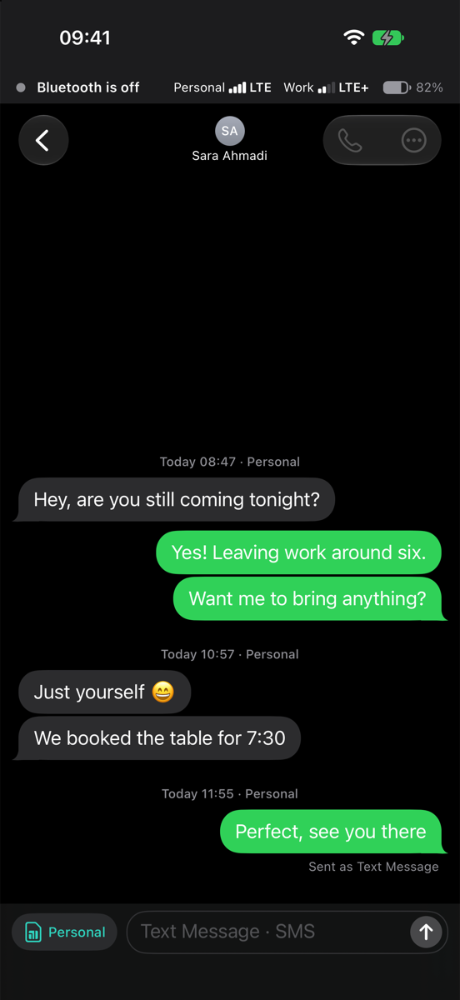
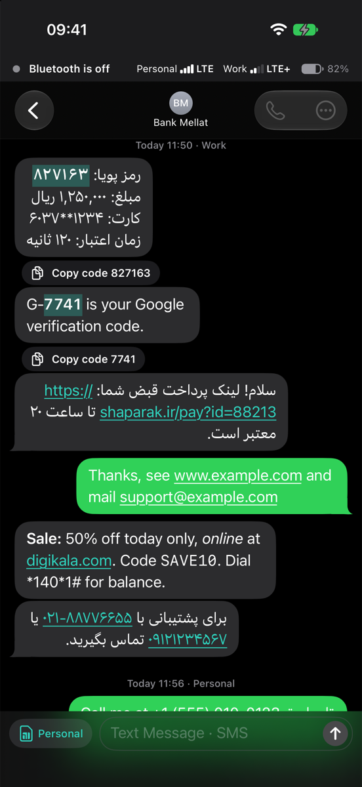
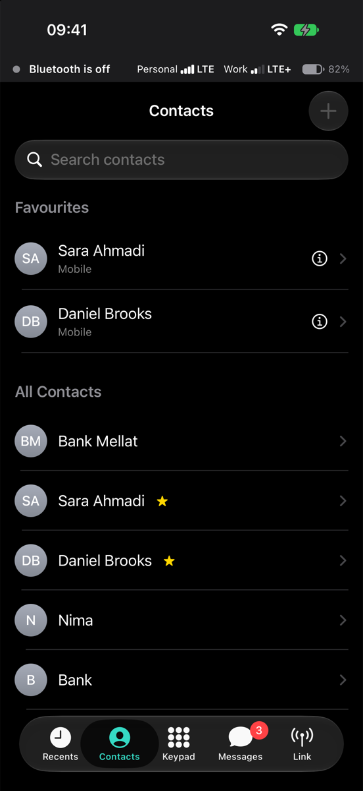
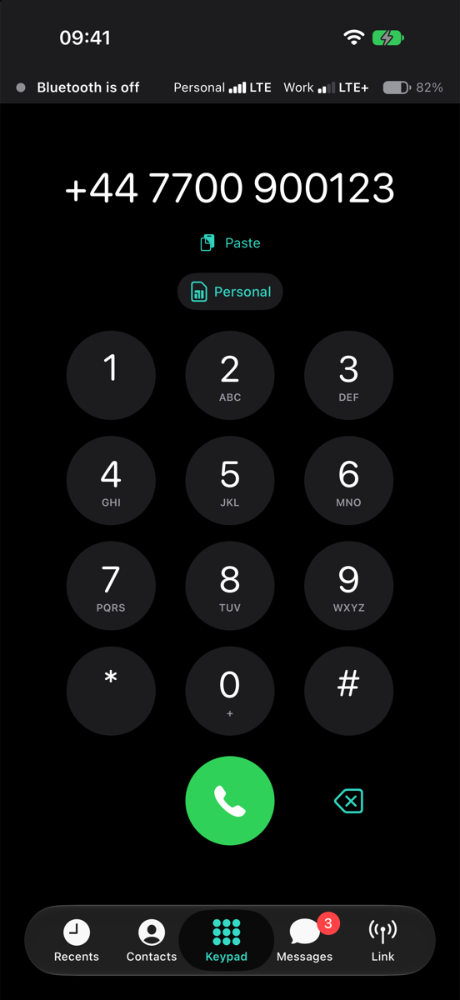
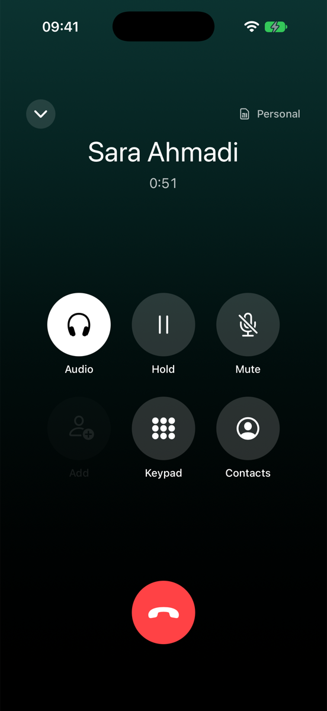
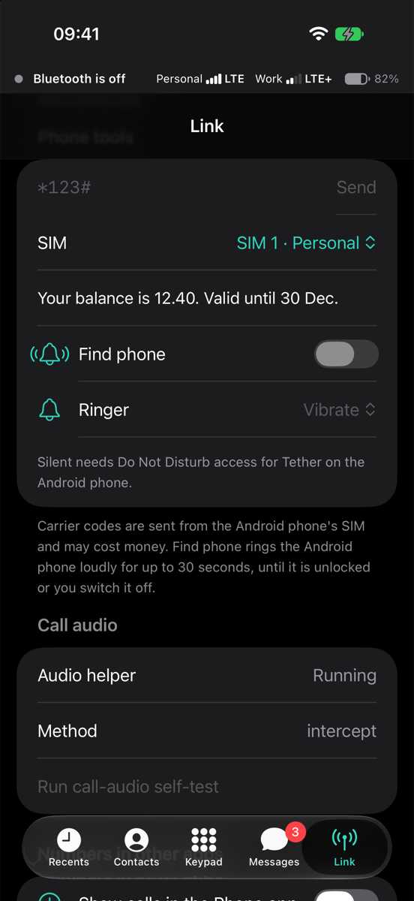
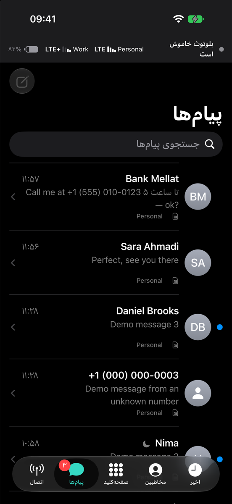

<p align="center"></p>

<h1 align="center">PolTell · پل‌تل — iPhone</h1>

<p align="center"><b>A bridge between your Android phone and your iPhone.</b><br>
The Android phone keeps the SIM cards (it can stay in a bag); calls, texts, contacts and call history appear on the
iPhone, over an end-to-end encrypted Bluetooth link with no server and no account.</p>

<p align="center" dir="rtl">پل‌تل تماس‌ها، پیامک‌ها، مخاطبین و تاریخچهٔ تماسِ گوشی اندرویدی که سیم‌کارت دارد را روی آیفون
می‌آورد؛ مستقیم از طریق بلوتوث و با رمزنگاری سرتاسری، بدون سرور و بدون حساب کاربری. آیفون به سیم‌کارت نیاز ندارد.</p>

PolTell is made of two repositories: **this one (iPhone)** and **[polltell-android](https://github.com/hrzjanati/polltell-android)**.
Both speak the same protocol ([protocol/PROTOCOL.md](protocol/PROTOCOL.md)); build and install both.

<table>
  <tr>
    <td align="center"><br><sub>Recents</sub></td>
    <td align="center"><br><sub>A conversation</sub></td>
    <td align="center"><br><sub>One-time codes</sub></td>
    <td align="center"><br><sub>Contacts</sub></td>
  </tr>
  <tr>
    <td align="center"><br><sub>Keypad</sub></td>
    <td align="center"><br><sub>In a call</sub></td>
    <td align="center"><br><sub>Phone tools</sub></td>
    <td align="center"><br><sub>Persian</sub></td>
  </tr>
</table>

*iPhone app screenshots (simulator, demo data with test numbers and made-up names).*

## What works

- **Calls** through the iPhone's own call screen (CallKit): incoming ringing, answer, decline, dial, hang up, hold,
  mute, keypad tones, speaker, call waiting, "move the call here" between devices. Call audio is bridged both ways
  (Opus, wideband) on Android phones that allow it, see [Compatibility](#compatibility). An **Audio** menu moves a
  call to a Bluetooth headset or the car and back.
- **Numbers from other apps**: a "Call with" action for Shortcuts and Siri (also finds a number in shared text),
  `tether://dial` links, call-backs from the Phone app's Recents, and on iOS 18.2+ with a paid developer account,
  the default calling app for `tel:` links. Numbers are grouped like phones show them, on the keypad as you type.
- **Messages** (SMS): every conversation, live new texts, send from either SIM, read state shared with the Android
  phone, delete, mute, block, one-time codes with a Copy button, links and phone numbers recognised.
- **Contacts**: browse, search, edit, add, favourites; **Recents**: search, delete, clear, missed-call badge.
- **Notifications** for texts and missed calls, with quick reply.
- **Link tab**: battery and signal of each SIM, and remote switches for mobile data, the data SIM, Wi-Fi hotspot,
  Bluetooth tethering, airplane mode, network mode, and "Share VPN" (use the Android phone's VPN from the iPhone).
- **Phone tools**: carrier codes such as a balance check (USSD) on either SIM, "Find phone" (the Android phone rings
  loudly) and its ringer mode.
- English and Persian (right to left), in a dark design.

### On a second Android phone

The **Android client** (`android/client`, "PolTell Client") does the same on another Android phone (Android 10 or
later): pairing by QR code, calls through Android's own call system (Bluetooth headsets and the car included) with
audio both ways, the keypad, Recents, Contacts and Favourites, Messages, notifications, the Link screen and its
switches, and "Call with" for `tel:` links in other apps. See [docs/ANDROID-CLIENT.md](docs/ANDROID-CLIENT.md); it is
tested on the build machine only so far (against a simulated Android phone), not yet on a second phone.

## What you need (iPhone)

| | |
| --- | --- |
| iPhone or iPad | iOS 16 or later. No SIM card needed. |
| Mac | Xcode 16 or later with an Apple account (free is enough), [XcodeGen](https://github.com/yonaskolb/XcodeGen). |
| Android phone | Running PolTell from [polltell-android](https://github.com/hrzjanati/polltell-android). |

## Build and install

```bash
git clone https://github.com/hrzjanati/polltell-ios.git && cd polltell-ios
cp ios/Config/Local.xcconfig.example ios/Config/Local.xcconfig   # your team id and a bundle id unique to you
cd ios && xcodegen generate && cd ..
tools/reinstall-ios.sh                                            # builds, signs and installs on your iPhone
```

Or open `ios/Tether.xcodeproj` in Xcode, choose your team under Signing & Capabilities and press Run. With a free
Apple account the app must be reinstalled every 7 days. Then on the Android phone tap **Pair iPhone** and scan the code
from the iPhone's **Link** tab ([docs/SETUP.md](docs/SETUP.md)).
More: [BUILD](docs/BUILD.md) · [USAGE](docs/USAGE.md) · [TROUBLESHOOTING](docs/TROUBLESHOOTING.md) ·
[ARCHITECTURE](docs/ARCHITECTURE.md) · [TESTING](docs/TESTING.md).

## Compatibility

Tested on one pair only. Everything else is expected from the Android and iOS APIs used, not tried: please report
what you see (open an issue with your phone model, Android version and the Link log).

| Device / feature | Status |
| --- | --- |
| Samsung Galaxy A54, Android 17 (One UI) + iPhone 17 | **Tested**: everything above, including call audio |
| iPad (iOS 16+) | Builds and lays out in the simulator; untested on a device |
| Other Samsung phones, Android 13+ | Expected to work like the A54, including muting the phone's own earpiece and microphone during a bridged call |
| Other Android 13+ phones | Calls, messages, contacts and switches expected to work. Call audio works only if the build lets the shell user use the call-audio interception API; the phone's own earpiece is muted during a bridged call (voice-call stream), and on Qualcomm and MediaTek phones also its microphone, through each vendor's own audio controls (from their sources, untested on devices; the Link tab shows "Android phone silent") |
| Android 11-12 | Everything, with call audio on a best-effort path (voice-call capture); untested |
| Android 10 | Everything except call audio; the helper needs the TCP adb path; untested |
| Single-SIM phones | Expected to work; SIM choices are hidden |
| Phones without Wi-Fi hotspot or Bluetooth tethering | Those switches are hidden |
| Bluetooth tethering between the same two phones | Works; the link then runs over its GATT transport (see [TROUBLESHOOTING.md](docs/TROUBLESHOOTING.md)) |

Device notes for the test phone, and how to check your own: [docs/devices/galaxy-a54.md](docs/devices/galaxy-a54.md).

## Security in brief

Pairing is a one-time QR code that carries the Android phone's public key and a short-lived token. Every session
starts with a P-256 key agreement that authenticates both sides; everything after it is encrypted with AES-GCM.
Bluetooth's own pairing is not used or trusted. Nothing leaves the two devices. Details and the threat model:
[SECURITY.md](SECURITY.md).

## Limits

- One iPhone or iPad per Android phone at a time is the supported setup. The Android client can be paired next to it
  (protocol §5.1); that combination is untested on devices.
- Bluetooth range: the phones need to stay within a few metres.
- MMS, RCS, group messages, video calls and visual voicemail are not supported.
- iOS apps signed with a free Apple account expire after 7 days; rebuild with `tools/reinstall-ios.sh`.

## Legal

Use PolTell only with your own phones and SIM cards, and follow your local law on recording and handling calls and
messages. PolTell does not record calls.

## Credits and licence

PolTell is the [Tether](https://github.com/amirwmr/tether) project by the Tether authors, under a new name and icon
and split into an Android and an iPhone repository. The code is otherwise the same; the documentation in `docs/`
still uses the original name "Tether" (the Android app id `app.tether.android`, the iOS target `Tether` and the
`TetherCore` package keep their names). MIT, see [LICENSE](LICENSE); third-party components in [NOTICE](NOTICE).
